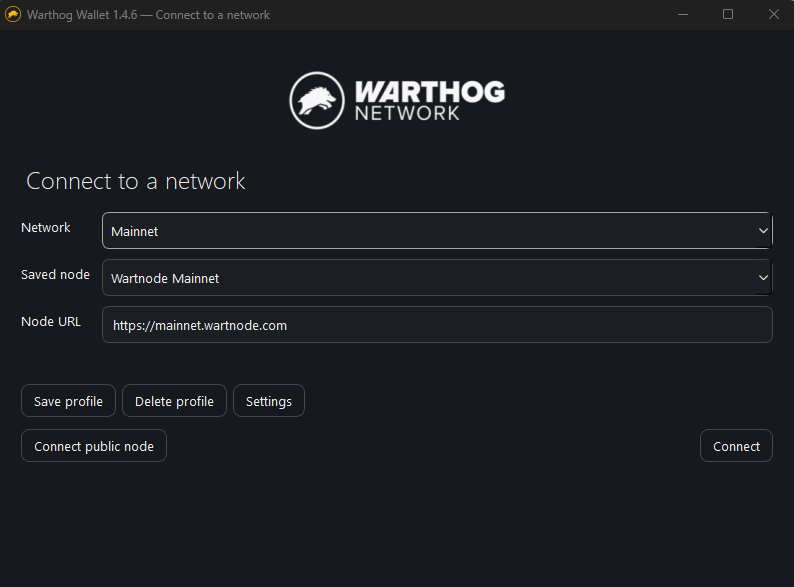
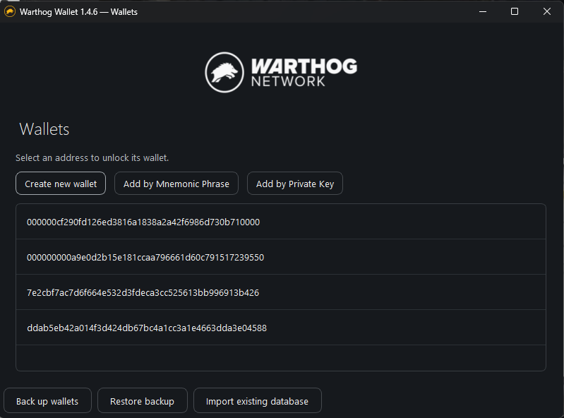
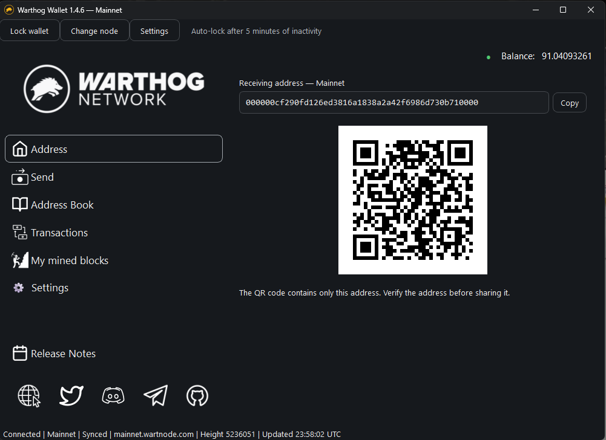
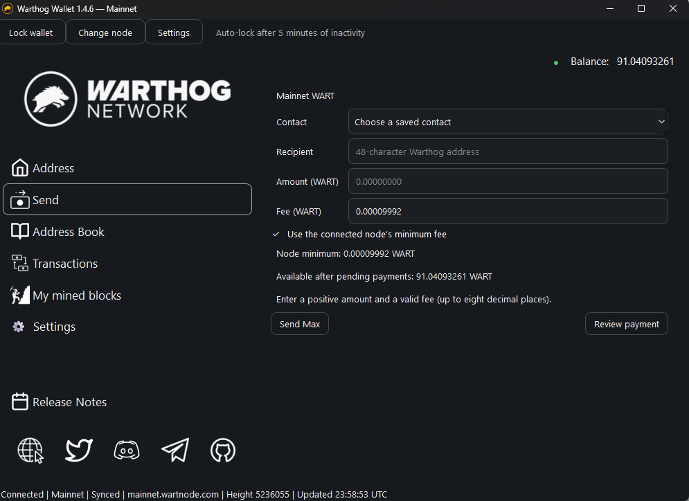
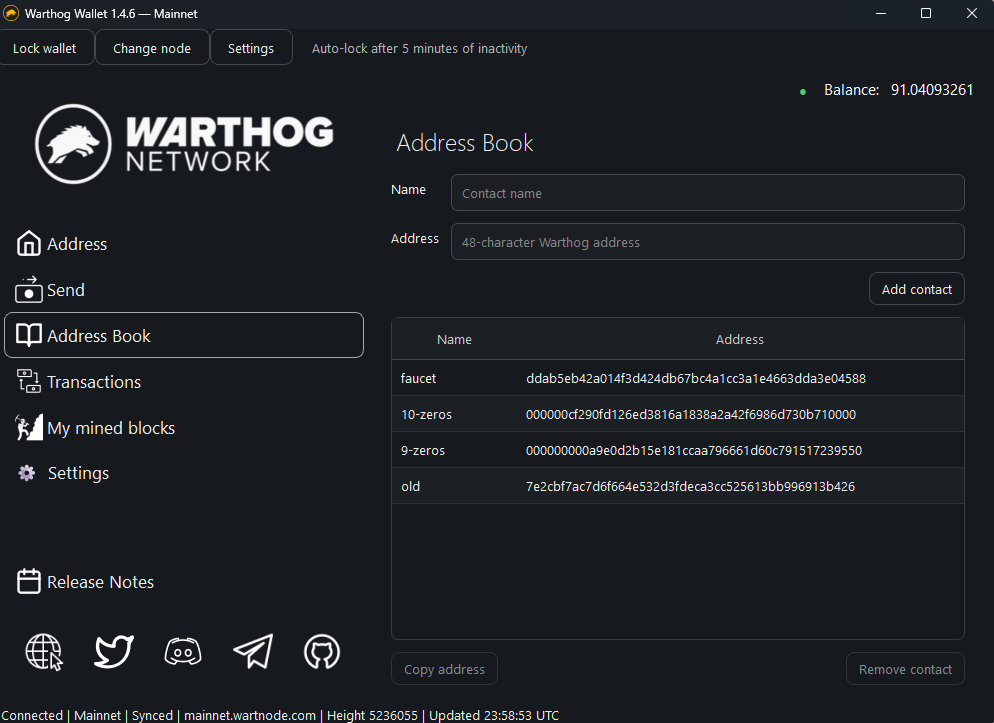
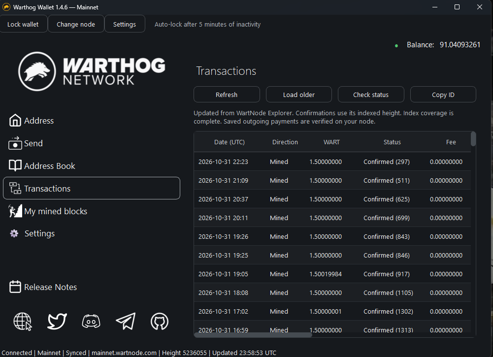
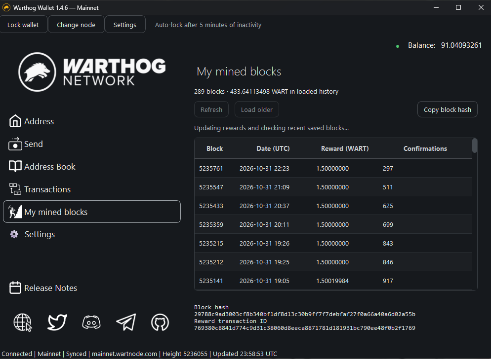
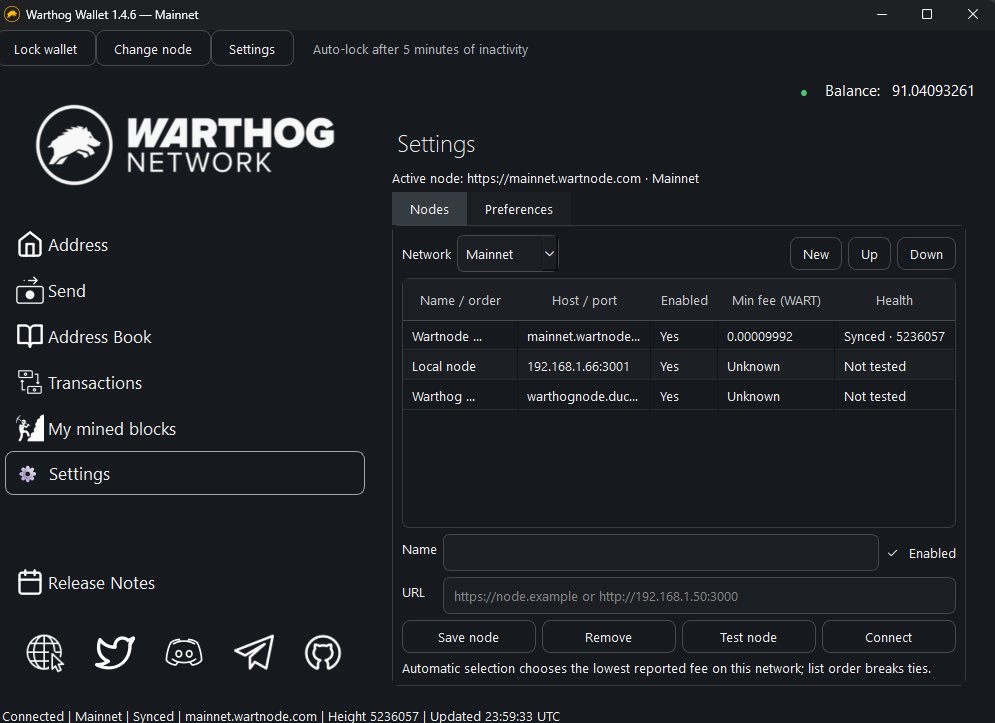
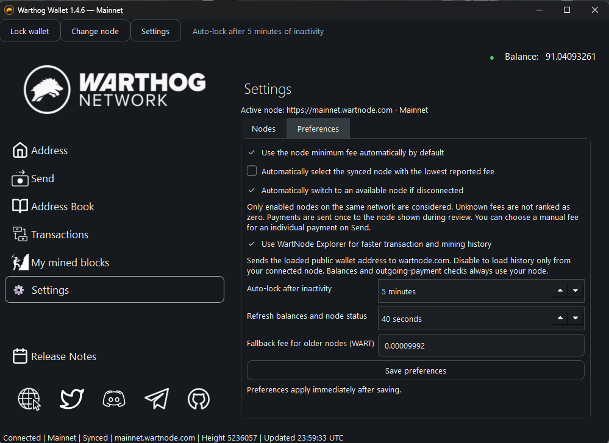

# Warthog Wallet 1.4.6

A Windows desktop wallet for Warthog mainnet and native WART payments on the
DeFi testnet. Private keys and signing stay on this computer.

[Screenshots](#screenshots) · [Build from source](#build-from-source-recommended) ·
[Using the wallet](#using-the-wallet) · [Backup and recovery](#backup-and-recovery)

## Screenshots

Warthog Wallet 1.4.6 on Windows, connected to Mainnet. Click an image to view
it at full size.

| Connect to a network | Wallet selection | Receiving address |
| --- | --- | --- |
| [](docs/screenshots/connect-network.png) | [](docs/screenshots/wallets.png) | [](docs/screenshots/receive-address.png) |
| **Send WART** | **Address Book** | **Transactions** |
| [](docs/screenshots/send-wart.png) | [](docs/screenshots/address-book.png) | [](docs/screenshots/transactions.png) |
| **My mined blocks** | **Node settings** | **Preferences** |
| [](docs/screenshots/mined-blocks.png) | [](docs/screenshots/settings-nodes.png) | [](docs/screenshots/settings-preferences.png) |

## Build from source (recommended)

We recommend building the wallet yourself from source. The Windows build script
installs pinned dependencies, runs the regression tests, and packages the wallet
from your checkout.

Install Git and 64-bit Python first. The Windows build and CI are tested with
**Python 3.14.6**. Run these commands in PowerShell:

```powershell
git clone https://github.com/JohnnyB813/wart-dapp.git
cd wart-dapp
py -3.14 -m venv .venv
powershell -NoProfile -ExecutionPolicy Bypass -File scripts\build-windows.ps1
```

The script uses `requirements-windows.lock`, records revision/source metadata,
checks the packaged executable, and creates an executable, ZIP and SHA-256
manifest in `dist/<version>/`. These paths refer to files created by your local
build. For version 1.4.6, start your built wallet with:

```powershell
.\dist\1.4.6\Start-Wallet.cmd
```

Use `Start-Test-Wallet.cmd` in that same folder for a separate, persistent test
profile. You can also extract the locally built ZIP and use either launcher
there. The packaged executable runs without a Python installation and is
unsigned. Use `-OutputDirectory dist/custom` with the build script if an existing
executable is still open.

## Run directly from source

To run the Python application without packaging an executable, clone the repo
and create `.venv` as above, then install the runtime dependencies and launch:

```powershell
.\.venv\Scripts\python.exe -m pip install -r requirements.txt
.\.venv\Scripts\python.exe launcher.py
```

For the separate test storage profile:

```powershell
.\.venv\Scripts\python.exe launcher.py --test-profile
```

## Using the wallet

### 1. Connect to a network

Start the wallet and choose **Mainnet** or **DeFi testnet** on the connection
screen. Select a **Saved node** and click **Connect**, or use **Connect public
node** to find an available node for that network. To use your own node, enter
its base URL in **Node URL**; **Save profile** stores it under a name for next time.

Connect to your node using a base URL such as `http://192.168.1.50:3000`.
HTTP works for localhost, RFC1918 private IPv4, IPv6 unique-local and link-local
IPs. Public IPs and other hostnames require HTTPS. LAN HTTP is unencrypted.
Save the URL as a named node profile. The status bar shows network, sync,
height and last successful update. Sending requires a synced node whose reported
network matches the selected network. Unknown networks cannot authorize payments.

### 2. Create, add or unlock a wallet

After connecting, the **Wallets** window lists saved addresses. Choose an option:

- **Create new wallet**: set and confirm a wallet password of at least eight
  characters. Write down the recovery phrase shown afterward and keep it private
  and offline before clicking **Done**.
- **Add by Mnemonic Phrase**: set a password for the imported wallet, then enter
  its complete original recovery phrase and click **Add wallet**.
- **Add by Private Key**: set a password, then enter the existing 64-character
  hexadecimal private key and click **Add wallet**.
- To open a saved wallet, click its address, enter its wallet password and click
  **Unlock**.

Use **Back up wallets** on this screen to save an encrypted backup. **Restore
backup** opens a `.wartbackup` file; **Import existing database** imports an older
wallet database. See [Backup and recovery](#backup-and-recovery) for password and
restore details.

### 3. Receive WART

Open **Address** in the sidebar. Check the displayed network, then click **Copy**
to copy the receiving address or let the sender scan the QR code. The QR contains
only the address, so share the intended network with the sender as well. Verify
the address before sharing it. Incoming payments appear under **Transactions**.

### 4. Send WART

1. Open **Send** and check the network label and available balance.
2. Choose a saved **Contact**, or paste the recipient's 48-character Warthog
   address into **Recipient**.
3. Enter the **Amount (WART)**, using up to eight decimal places. **Send Max**
   fills the available amount after the fee and pending-payment reservations.
4. Keep **Use the connected node’s minimum fee** checked for automatic fees, or
   clear it to enter a manual fee. Check the final fee and total shown below.
5. Click **Review payment**. Verify the recipient, amount, fee, total debit,
   network and node, then enter the wallet password and click **Confirm and send**.
6. Open **Transactions** to follow the result. Node acceptance is pending;
   confirmation requires inclusion in a block. If the result is uncertain,
   select the payment and use **Check status** before deciding what to do next.

### 5. Manage contacts and review history

- **Address Book**: enter a name and address, then click **Add contact**. Saved
  contacts become available in Send. Select a row to **Copy address** or
  **Remove contact**; removal asks for confirmation.
- **Transactions**: use **Refresh** for recent history and **Load older** for
  earlier entries. Select a row to **Check status** on your node or **Copy ID**.
  Dates are shown in UTC.
- **My mined blocks**: view rewards paid to this address, with block heights,
  dates and confirmations. Use **Refresh** or **Load older**, and select a block
  to inspect its details or **Copy block hash**. The count and total cover only
  loaded history.

### 6. Lock the wallet and adjust settings

Click **Lock wallet** to return to wallet selection. Inactivity also locks the
wallet after five minutes by default. **Change node** locks it and returns to
the connection screen so you can choose another node or network.

Open **Settings** to manage nodes under **Nodes**, or change fees, automatic
node selection, explorer history, auto-lock and refresh timing under
**Preferences**. Click **Save preferences** to apply those changes.

## Settings, multiple nodes and fees

Open **Settings** from the wallet sidebar or the connection screen. **Nodes**
lets you add, rename, edit, enable, remove and test nodes for each network. Use
**Up** and **Down** to set their order. **Connect** uses the selected node as the
starting point; automatic selection may choose a lower-fee configured node.
Manual node changes lock the wallet before reconnecting.

The wallet includes these saved profiles:

| Network | Localhost | Public nodes |
| --- | --- | --- |
| Mainnet | `http://localhost:3000` | `https://mainnet.wartnode.com`, `https://warthognode.duckdns.org` |
| DeFi testnet | `http://localhost:3100` | `https://testnet.wartnode.com`, `https://warthog-defitestnet.duckdns.org` |

The localhost ports match [Warthog Core's defaults](https://github.com/warthog-network/core/blob/defi/src/node/cmdline/cmdoptions.ggo).
Upgrading adds missing defaults once, keeping custom profiles, node order and
disabled flags. Profiles you remove afterward stay removed across restarts.

By default the wallet compares the reported minimum fees of responding, synced
nodes on the selected network and selects the lowest. The active node wins equal
fees; list order breaks other ties. Comparisons run on connection and during
periodic refresh. Disconnected nodes can fail over to enabled nodes on the same
network. Checking nodes happens in the background with bounded timeouts.
Disable automatic lowest-fee selection or failover in **Preferences** if desired.

The Send fee follows the connected node's minimum automatically. Clear **Use the
connected node’s minimum fee** to enter a manual fee. Older nodes may not expose
`/transaction/minfee`; they remain usable and default to **0.00009992 WART**.
Send and the confirmation identify when the node minimum is unavailable. Unknown
fees are never ranked as zero during automatic selection. The fallback fee can
be changed in Preferences. A lower fee may be rejected if an older node's actual
minimum is higher; adjust the manual/fallback fee or use a node that reports it.

Fee changes update the draft and total before review. An open confirmation stays
bound to its displayed node, amount and fee. The minimum is checked again when
available before signing; an increased minimum requires a new review. Broadcasts
are never retried on another node. Automatic node switches invalidate cached
balances and refresh them before another payment can be reviewed.

Preferences also control auto-lock (1–60 minutes, default 5) and refresh timing
(10–300 seconds, default 40). Node order, enabled flags and preferences persist
across restarts and are included in encrypted backups. Restore keeps preferences
already saved in the destination profile.

**Use WartNode Explorer for faster transaction and mining history** is enabled
by default in Preferences. It sends the loaded public address to
`https://wartnode.com/api/v1/<network>` for read-only indexed history. Disable it
to use only your connected node for history. Signing, balance checks, fees,
broadcasts and saved outgoing-payment status checks continue using your node.

## DeFi testnet

On the connection screen, choose **DeFi testnet**, select the included
**Wartnode DeFi testnet** profile (`https://testnet.wartnode.com`), and click
**Connect**. The public-node button checks both bundled public testnet nodes.
You can save other testnet node URLs as named profiles.

Create or unlock a wallet, then open **Address** to copy its address or scan its QR code.
Once that address has test coins, use **Send**, review the amount and fee, and
authorize with the wallet password. The initial fee comes from the node's minimum;
changes to that minimum are shown on Send and checked again before review.
Transactions and My mined blocks support testnet's account-history format.
This release supports native testnet WART; token transfers, swaps and liquidity
operations are outside this release's scope.

Mainnet and testnet use the same address format and wallet keys, but their balances,
history and pending-payment reservations are separate. Always check the network
shown on Address and in the payment confirmation. **Change node** locks the wallet
before switching networks. Testnet coins have no mainnet value.

The **test profile** is a separate storage profile, independent of the
network selector. Either storage profile can connect to either network.

## Wallet data and old databases

Normal Windows data folder:
`%LOCALAPPDATA%/WarthogNetwork/WartWallet/wartwallet.db`

Separate test profile:
`%LOCALAPPDATA%/WarthogNetwork/WartWallet-Test/wartwallet.db`

Both paths stay the same when the application moves to another release folder.
A single legacy database next to the executable or in the working directory is
copied on first use; the original is kept. Multiple candidates require a choice.
The test profile looks for `wallet-test.db`, never the production database.

For older test builds in `dist/` or `dist/lan/`, choose **Import existing
database** on the wallet-selection screen and select that build's
`wallet-test.db`. Import merges encrypted records without replacing wallets
already in your profile. The original file is left intact.

An explicit override remains available, for example when testing a copy:

```powershell
.\.venv\Scripts\python.exe launcher.py --wallet-db C:\path\to\copied-wallet.db
```

## Backup and recovery

Use **Back up wallets** on the wallet-selection screen. Choose a separate
backup password and save the `.wartbackup` file somewhere protected.
The complete snapshot is encrypted and authenticated with a fixed Scrypt KDF
and Fernet. Never overwrite your live database with a backup file.

Use **Restore backup** to decrypt and validate it, then merge wallets, contacts,
payment history and node profiles into the current profile. Existing wallet
records and their passwords are preserved. Conflicting node profile names get
a restored suffix. Restore commits atomically; malformed backups add nothing.

The backup password protects the backup container. **Original wallet passwords
are still required after restoration.** The legacy wallet cipher, recovery
phrase mapping, address derivation and pasted multiline passwords are preserved.
Keep the original recovery phrase offline; it cannot be reconstructed from a
stored private key.

## Locking and payments

Use **Lock wallet**, or wait for the configured inactivity timeout (five minutes
by default). Every payment also
requires its wallet password. The app retains no signing key for the unlocked
session. A send already being broadcast can finish after a lock; its result is
saved without reopening the wallet. A lock during preparation prevents a new
broadcast.

The Send screen provides contacts, Send Max, locally rounded final fees and
exact amount-plus-fee totals. Available balance subtracts pending/uncertain
outgoing payments. Balances are checked again before signing; a SQLite
reservation is committed before the POST, including across app processes.
The Address screen's QR contains only the receiving address and is generated
locally without a third-party service.

Address Book uses the same compact controls as Send. Contacts appear in separate
name and address columns; select one and choose **Copy address** to copy it in full.
Saved contacts are also available from the Send page's contact selector.
Select a contact and choose **Remove contact**, then confirm, to remove that entry
from Address Book and the Send selector. Other saved entries remain available.

## Personal history

Transactions lists this wallet's incoming, outgoing and mining payments, with
UTC dates, amounts, fees, other addresses, IDs and confirmations. WartNode's
[Explorer API](https://wartnode.com/openapi.json) loads up to 100 indexed actions
per request, including timestamps, avoiding a separate header request for each
block. Mainnet and DeFi testnet use separate API namespaces and cursors. Other
DeFi actions are omitted from this native-payment view. Saved history remains
visible offline.

The page identifies its source and incomplete index coverage; explorer
confirmations use the indexed height. Stale, lagging, disabled, malformed or
unavailable explorer responses fall back to your node. Pagination then restarts
at the latest node page and merges saved IDs; Load older continues on the node.
At the end of an incomplete index, Load older also offers node history. A chain
reset invalidates the explorer cursor and requires Refresh. Requests share a
rate budget across networks and respect Retry-After without automatic retries.
Explorer observations cannot change journaled or pending payments or release
their balance reservations, including across wallet processes.

**My mined blocks** replaces Miners Chain. It shows mining rewards paid to the
loaded wallet's address, grouped by block, with height, UTC date, reward and
confirmations. Select a block to see and copy its block hash and select its reward
transaction ID. The explorer queries rewards directly; the selected block's hash
loads from the node on demand and stays available for the current wallet session.
Refresh verifies saved rewards missing from the latest indexed page's height
range directly on the node. With explorer history disabled or unavailable,
refresh rechecks the 100 most recent saved rewards through the node, removing
rewards no longer found there. Load older follows the active source's cursor,
including pages with no native mining rewards. Counts and reward
totals cover loaded history, rather than claiming a lifetime total. An address
only receives this attribution when the block reward was paid to it; pool payouts
appear as incoming payments in Transactions.

An outgoing payment is saved **before** broadcast using the locally computed
transaction ID. Node acceptance means pending, not confirmed. Lost, malformed
or mismatched replies stay uncertain. Refresh checks the saved ID; a not-found
reply is not proof that a payment failed. Uncertain payments continue reserving
their amount and fee. Nothing is automatically retried or re-signed.

## Development and regression tests

The recommended build command runs the full test suite. To run tests separately,
install the test dependencies in your virtual environment and run:

```powershell
.\.venv\Scripts\python.exe -m pip install -r requirements-test.txt
.\.venv\Scripts\python.exe -m unittest discover -s tests -v
```

Application dependencies are in `requirements.txt`; `requirements-test.txt`
adds an independent QR decoder, and `requirements-build.txt` adds PyInstaller.
Pillow and the QR decoder are test tools and are excluded from the executable.
Automated checks use public synthetic keys and a loopback mock node; they never
send real WART. No live-chain transfer has been certified.

GitHub's Windows workflow runs the same build/test/package command for pull
requests, main/master pushes, version tags and manual runs. Tags must match
`version.txt`. Downloadable CI ZIP/checksum artifacts are retained for 30 days;
the workflow does not automatically publish a GitHub release. Wallet databases
and backup files are excluded from the release ZIP.

The app displays the release version, build revision and current release notes.
`build-info.json` records the exact runtime-source digest, revision, local-change
status, Python version and build time. `SHA256SUMS.txt` covers release files and
the ZIP; compare an executable's hash with `Get-FileHash -Algorithm SHA256`.
